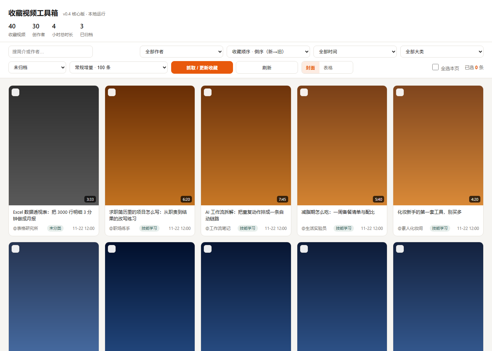
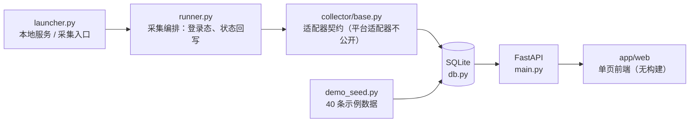

# 收藏视频工具箱 · 本地收藏管理

[](https://github.com/assist1st/favtool-video-lib/actions/workflows/smoke.yml)



**把我自己 1794 条收藏、1156 个作者，做成一个能筛选、能归档、能导出的本地工具。**

起因很具体：收藏夹只进不出，越攒越吃灰。想找一条三年前存的东西，只能一直往下滑；滑到最后放弃，等于那条视频从来没存过。

---

## 做了什么

- 登录后分页抓取**本人账号**的收藏，按平台真实收藏顺序落 `fav_seq`
- 分类：技能学习 / 影视解说 / 生活消费 / 情绪共鸣 + 未分类（规则分类器，窄类优先）
- 筛选：类目 × 月份（入库 `first_seen` / 发布 `create_time` 双口径）× 正倒序，纯前端组合过滤
- 本地归档：只标本地 `archived`，不碰平台的收藏状态
- 批量导出 CSV，字段可自选

## 架构

```
launcher.py          → 起本地服务 + 打开浏览器
app/main.py          → FastAPI 路由（items / stats / authors / export / archive）
app/db.py            → SQLite：建表、迁移、查询、分类打标
app/runner.py        → 采集编排：起浏览器、登录态检查、状态回写、存活检测
app/collector/base.py → 适配器契约（五个方法，核心逻辑不感知平台差异）
app/classify.py      → 规则分类器
app/covers.py        → 封面按需下载与缓存
app/web/             → 前端（单页，无构建）
```



核心逻辑与平台解耦：换一个平台，只换 `collector/` 下的适配器，`db` / `main` / `web` 不动。

## 三个真正花时间的地方

### 一 · 增量判定

每次全扫 3 分钟不可接受。改成「已知 id 集合」对比：每批数据只要有一条不在库内就继续滚；**连续 8 批全是老条目，判定已追平，提前结束**。无变化时 24 秒收工（其中 14 秒是启动浏览器）。

代价是「消失检测」降级：完整扫到底且没撞上限时，才在状态栏提示「另有 N 条本次未出现」。

### 二 · 1794 条的渲染切分

不分页时切视图会明显卡顿。改成 **100 条/页** + 点选只切该卡样式、不重建整页 + 归档视图改为一次取 `archive=all` 后前端过滤（切换不再发请求）。

### 三 · 用归档代替取消收藏

取消收藏不可逆，一次误触就是永久丢失。改成只在本地标 `archived`，三视图（未归档 / 已归档 / 全部）随时可切，撤销零成本。

## 实测（2026-11-22，库内 1794 条）

| 指标 | 数值 |
|---|---|
| 首屏渲染 | 1.7 s |
| 切视图 | 2–8 ms |
| 点选 | 1.0 ms |
| 排序 | 6–8 ms |
| 类目筛选 | 7–8 ms |
| 月份筛选 | 6–12 ms |
| 无变化增量 | 24 s（含启动浏览器 14 s） |
| 单次完整扫描 | 约 3 分钟 / 1779 条 |
| 打包体积 | 62 MB 单文件 exe |

## 边界（重要）

- **只处理本人账号的收藏**，不碰他人数据
- **平台适配器不随本仓库分发**：`app/collector/douyin.py` 不在仓库里。原因是平台接口解析属合规灰区，且对读者没有展示价值。`collector/base.py` 保留了完整契约，自己接一个适配器即可运行
- **不含任何真实收藏数据、作者信息、账号态**：`data/` 不入库
- **不做取消收藏**：不可逆操作不在这个工具里

## 运行

**两条路径，demo 模式不需要平台适配器就能跑起来看界面。**

```bash
pip install -r requirements.txt

# 1) 只看界面 / 跑通筛选、归档、导出：demo 模式
python launcher.py --demo
# 内置 40 条虚构示例（四类目、六个月、含 3 条已归档），
# 独立数据库 data/demo.db，端口 8788，不联网、不碰任何真实收藏

# 2) 接自己的账号：需要自己实现一个适配器
python launcher.py            # 起服务
python launcher.py --collect  # 抓取本人收藏
```

`--demo` 走的还是同一套 `db` / `main` / `web`，只是换了一份示例数据与端口——所以它演示的就是真实界面，不是另做的假页面。

采集路径需要 `app/collector/douyin.py`（未分发）；只读代码、看表结构、跑分类器、跑 demo 都不需要。

## 测试

```bash
python -m unittest discover -s tests -v     # 规则分类器 8 条用例，零依赖
```

CI（`.github/workflows/smoke.yml`）只做编译检查和分类器单测，不安装 FastAPI / Playwright——适配器不在仓库里，装全依赖既慢也没意义。

## 目录

```
launcher.py
app/                核心代码
docs/               三篇设计说明
README.md
LICENSE             代码 MIT
```

## 许可

代码 MIT；文档 CC BY-NC-ND 4.0。

---

首发于 github.com/assist1st/favtool-video-lib · 2026-11
